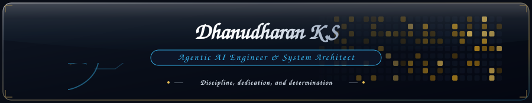
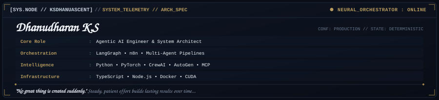

  

  
Designing autonomous AI agents and modular systems that perceive context, reason with precision, and execute reliably. Focused on multi-agent orchestration, behavioral intelligence, and deterministic automation.

  

  

  

